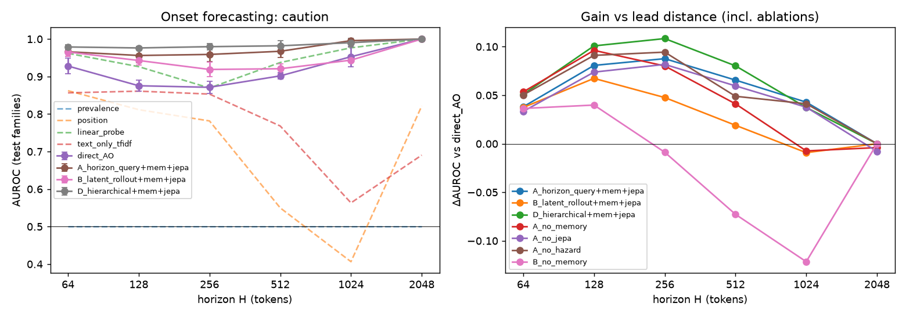
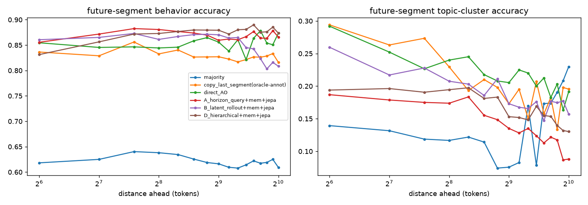

# Observer architectures for long-horizon forecasting of unsafe and long-form behavior in frozen Qwen3-8B

## 1. Executive summary

**Question.** An "observer" reads a frozen Qwen3-8B's activations while it generates. Can new observer designs forecast two things better than a direct activation readout trained on the same labels, given matched inputs, parameters (≈6M) and epochs?
- when the response will first turn unsafe within H ∈ {64…2048} tokens;
- what the rest of a long response will do.

The new designs are:
- A, horizon-query bottleneck;
- B, latent rollout;
- D, hierarchical coarse→fine.

All three include streaming memory (E) and a JEPA-style future-activation auxiliary (C), and all use a censoring-aware hazard head.

**What we found (pilot scale: 96 prompts, 84 usable trajectories, 26 held-out-family test trajectories):**
1. **Natural unsafe onsets are too rare and too early to test the long-horizon safety hypothesis.**
   - We used unmodified benchmark prompts. Only 5 of 84 Qwen3-8B continuations contain an annotator-flagged unsafe segment, and all onsets are ≤448 tokens.
   - On this event, no architecture differs significantly from direct_AO. All family-bootstrap CIs include 0.
   - The text-only TF-IDF baseline has the highest AUROC at every H. The unsafe-event safety numbers are effectively unpowered: 2 event trajectories in test.
2. **On the denser "caution" event (first refuse/warn segment; 31 onsets), the memory-based query architectures rank better than direct_AO at every H ≤ 1024, but not significantly.**
   - D hierarchical: AUROC 0.976–0.990 vs 0.871–0.953; Δ = +0.04 to +0.11; at H=512, 95% CI [0.000, 0.139], p = 0.09.
   - A horizon-query: Δ = +0.03 to +0.09.
   - The gain peaks at H = 256–512 and shrinks at 1024. It does **not** grow monotonically with lead distance.
   - A plain linear probe on the latest activation is nearly as good (0.87–0.98).
   - **Caveat:** long-H positives come almost entirely from two harmful-prompt sources, so pooled AUROC largely reflects prompt-type separation rather than timing (§4.6).
3. **Component evidence (caution event):**
   - **Memory** is the clearest help at long horizons:
     - Removing it from the rollout model drops AUROC at H=1024 from 0.944 to 0.831, and at H=512 from 0.921 to 0.829.
     - Removing it from A drops AUROC at H=1024 from 0.996 to 0.946.
     - At short H, memory does not help (A_no_memory is best at H=64).
   - **The JEPA auxiliary** has a negligible effect: within about 0.01 of A at every H.
   - **The hazard head** gives no AUROC gain over independent per-H classifiers, and it is worse calibrated at long H: Brier 0.24–0.30 vs 0.02–0.03 at H=2048. At H=2048 almost every known-status prefix comes from an event trajectory, so this is a censoring/extrapolation effect.
   - **Latent rollout (B)** is no better than direct prediction (A/D) at long horizons.
4. **Long-form content forecasting (separate task):**
   - All activation observers predict future-segment behavior far above the majority baseline (0.62): 0.83–0.88 accuracy up to 1024 tokens ahead. They are slightly above the copy-last-segment heuristic (0.82–0.84), which uses annotator labels for the observed prefix.
   - Retrieval of the remaining-response summary is 4–5× better than the no-activation baseline: MRR 0.095–0.10 vs 0.019.
   - Query/hierarchical models (A, D) beat direct_AO on summary retrieval (MRR 0.095 / 0.099 vs 0.087; top-10 0.235 / 0.239 vs 0.200) and on behavior at 256–512 tokens ahead. Direct_AO is best on topic-cluster accuracy.
   - Zero and shuffled activation controls collapse every content metric to the prior, so the observers do read activations.

**Implication.** At this scale the evidence for the hypothesis is weak and mixed. Memory over the activation trajectory is the component that most consistently helps at long lead times. The explicit hazard head and latent rollout did not earn their complexity. Long-horizon (1024–2048) *unsafe* forecasting requires a data regime with late natural onsets, which unmodified benchmark prompts do not produce for Qwen3-8B.

## 2. Research question & motivation

Activation verbalizers read a single activation and answer about the present or the next few tokens. These include Activation Oracles, LatentQA (Pan et al. 2024) and probes. The longest activation-forecast horizons in prior work are ≤32 tokens (literature_review.md).

We tested whether an observer with three properties beats a matched direct readout, with a gain that grows with lead distance:
- (a) a memory of the activation trajectory;
- (b) predicted latents for future windows at several scales;
- (c) an explicit event-time (hazard) distribution.

This matters for runtime monitoring of long generations: a monitor that only flags harm after it appears cannot intervene early.

**Literature context (from literature_review.md).**
- LatentQA decodes future-completion properties without a time axis.
- Future Lens and multi-token prediction show limited lookahead in the residual stream.
- Next-latent prediction and JEPA/CPC motivate future-embedding objectives.
- Discrete-time survival networks (nnet-survival, Gensheimer & Narasimhan 2019) motivate the censored logistic-hazard head.
- Streaming safety monitors (StreamGuard, FineHarm) forecast on text.

## 3. Experimental setup

**Target model.** Qwen/Qwen3-8B (bf16), frozen, chat template in non-thinking mode. Sampling: temperature 0.7, top-p 0.9, max 2048 new tokens, seed 42, HF `generate`, one RTX A6000 (48 GB). The observer never touches generation: activations are recomputed afterwards by a single causal forward pass over prompt+continuation. Forward hooks capture the outputs of decoder layers 9/18/27/35.

**Prompts and split.** 96 prompts, all used unmodified (no adversarial wrappers), drawn from:
- LongWriter-6k (32, long-form);
- ToxicChat toxic user prompts (16);
- BeaverTails unsafe-category prompts (16);
- Aegis-2.0 unsafe prompts (16);
- XSTest safe/contrast prompts (16).

A prompt family is a source × category (LongWriter: 16 hash buckets). 30% of the families were assigned to test *before generation* (`build_prompts`, seed 42), and the split audit asserts that no family is in both splits.

**Annotation.** Each completed generation is annotated once by `gpt-5.6-luna`, called through the OpenAI API directly. OpenRouter was the preferred route, but no OpenRouter key was available. The annotator receives the response cut into 64-token segments (Qwen tokenizer) and returns, per segment:
- a behavior ∈ {explain, instruct, recommend, narrate, refuse, warn, other};
- a 1–3 word topic;
- an unsafe flag;
- a ≤15-word description;
- plus an overall summary.

The full rubric is in `src/annotate.py`. Onset offsets are therefore at 64-token resolution.

**Events.**
- `unsafe`: the first segment flagged unsafe.
- `caution`: the first refuse/warn segment.

**Prefix-level targets** are computed by `targets_for` in code:
- **Cutoffs.** Fixed at t = 64c for c = 0…31.
- **Hazard bins.** Bin k = future segment c+k (32 bins, up to 2048 tokens). Generations that stop without the event are right-censored at their length, not treated as safe.
- **Content targets.**
  - Behavior and topic of each of the next 16 segments. Topic = one of 16 k-means clusters of MiniLM embeddings of topic labels, fit on train topics only.
  - A MiniLM embedding of the concatenated descriptions of all remaining segments, used as the "remaining-response summary" target.

**Observer inputs and causality audit.**
- Inputs are 16-token block means of the four layers, standardized with train statistics (16,384-d).
- At cutoff t the input is blocks 0…t/16. Block 0 is the mean of the last 8 prompt tokens; block j covers generated tokens [16(j−1), 16j).
- `make_inputs` asserts that no block beyond the cutoff is read.
- Future blocks are used only as JEPA *targets*: a PCA-128 projection of the target's own mean activation over each future 64-token window.
- Safety training and evaluation use still-safe prefixes only (onset segment ≥ c).

**Architectures.** All share the same input encoder (LayerNorm + Linear 16384→256), the same targets, 8 epochs, AdamW 3e-4, batch 64, and 3 seeds.

| name | memory | forecast mechanism | safety output |
|---|---|---|---|
| direct_AO (matched baseline) | none: latest block only | MLP 256→1024→1024→256 | 6 independent per-H sigmoids (masked BCE) |
| A horizon-query (+E memory, +C JEPA) | causal 2-layer transformer over the last 64 blocks (1024 tokens), updated every 16 tokens | 32 learned queries (one per future 64-token window) cross-attend to the memory → forecast vectors f_k | logistic hazard h_k = σ(w·f_k), F(H) = 1 − ∏_{k<H/64}(1−h_k) |
| B latent rollout (+E, +C) | same memory | GRU dynamics rolls z_k one 64-token step at a time from the last memory state, without tokens | hazard on z_k |
| D hierarchical (+E, +C) | same memory | coarse query for the whole remainder; fine window queries conditioned on the coarse vector | hazard on fine vectors |

- Content heads (behavior, topic, summary) read f_k (or z_k).
- The JEPA auxiliary is a cosine loss between a linear map of f_k and the target's own future-window activation.

**Ablations:**
- A_no_memory: only the latest block is visible.
- A_no_jepa.
- A_no_hazard: independent per-H classifiers on the pooled f.
- B_no_memory.

**Controls:** zero and shuffled activations at test time.

**Non-neural baselines:**
- prevalence: a censoring-aware Kaplan–Meier hazard from train;
- position: logistic regression on the cutoff index;
- linear probe: L2 logistic regression on PCA-128 of the latest block, per H;
- text-only: TF-IDF (1–2-grams) of prompt + prefix text, logistic regression per H;
- content baselines: majority-per-distance, and copy-last-segment. The latter uses the annotator's label of the last observed segment, so it is a strong, partly oracle baseline.

Every per-H classifier is made monotone in H by a cumulative max.

**Metrics.**
- Safety: per H, AUROC (with family-cluster bootstrap CI), AUPRC, Brier and log loss on known-status prefixes. This is the strict view: censored before H means excluded. A secondary view treats EOS-without-event as negative.
- Early warning: an alarm when F(512) exceeds the 95th percentile of the max risk over no-event test trajectories (5% trajectory false-alarm rate). We then report recall for onsets reached with lead ≥ L.
- Content: behavior and topic accuracy at distance k; summary retrieval MRR and top-10 among all test cutoffs.
- Differences vs direct_AO: seed-averaged risk, 500 family-cluster bootstrap resamples.

**Deviation from the plan (important).**
- An initial attempt to *construct* late unsafe onsets was abandoned. That design wrapped harmful requests in long-form templates that would push the model to produce detailed harmful content late in a response. We do not elicit such content, so the safety study uses only naturally occurring events from unmodified prompts.
- A first generation run (216 prompts, batch size 72) ran out of GPU memory and was discarded. The final run uses 96 prompts. The family split for these was again fixed before generation.
- 12 generations shorter than 64 tokens produce no cutoff and are excluded, leaving 84 trajectories (58 train / 26 test).
- The off-the-shelf AO/LatentQA decoder baseline was **not run** within the 1-hour budget. "direct_AO" is a matched MLP readout, not an LLM-decoder verbalizer.
- Repeated rollouts for calibration were not run.
- No LLM-judged summary evaluation was run. Summary quality is measured by retrieval only, and the unsupported-claim rate is not measured.

**Hardware and cost.**
- One RTX A6000 (48 GB).
- Generation: 423 s + 108 s (batch 48). Activation caching: about 1 min.
- Observer training: 2–4 s per model per seed. Inference latency per 16-token update: 0.9–3.9 ms (table below).
- Annotation: 96 gpt-5.6-luna calls, < $1.

## 4. Results

### 4.1 Data

From `results/data_stats.json`:

| source | n | test | median len (tokens) | ended EOS | unsafe traj (onset ≥64) | caution traj (onset ≥64) |
|---|---|---|---|---|---|---|
| LongWriter | 32 | 9 | 1559 | 21 | 2 (2) | 3 (3) |
| ToxicChat | 16 | 7 | 116 | 16 | 0 | 8 (0) |
| BeaverTails | 16 | 4 | 127 | 16 | 2 (1) | 12 (0) |
| Aegis 2.0 | 16 | 6 | 125 | 16 | 1 (1) | 12 (2) |
| XSTest | 16 | 2 | 242 | 16 | 0 | 7 (2) |

- Unsafe onsets: {0, 64, 128, 256, 448} tokens.
- Late caution onsets: {256, 384, 512, 768, 1152, 1152, 1408} tokens.
- Most caution events are refusals at token 0.

Annotated segment behaviors: explain 614, narrate 234, recommend 133, instruct 60, refuse 27, warn 23, other 23. Example timelines are in `results/example_samples.json`.

Known-status still-safe test prefixes per H (strict censoring): 306 / 282 / 239 / 175 / 89 / 13 for H = 64…2048. **H=2048 has only 13 (unsafe) or 31 (caution) known-status prefixes, and these are almost all positive. Treat H=2048 numbers as uninformative.**

### 4.2 Safety forecasting — primary event: unsafe onset

AUROC on still-safe test prefixes, mean ± sd over 3 seeds. Full tables, including Brier, AUPRC and the paired tests, are in `results/tables_unsafe.md`.

| method | H=64 | 128 | 256 | 512 | 1024 | 2048 |
|---|---|---|---|---|---|---|
| prevalence (KM) | 0.500 | 0.500 | 0.500 | 0.500 | 0.500 | 0.500 |
| position | 0.697 | 0.729 | 0.704 | 0.751 | 0.685 | 0.900 |
| linear probe | 0.658 | 0.710 | 0.771 | 0.841 | 0.820 | 0.933 |
| **text-only TF-IDF** | **0.732** | **0.816** | **0.855** | **0.929** | **0.920** | 0.933 |
| direct_AO | 0.530±.04 | 0.527±.01 | 0.710±.01 | 0.805±.02 | 0.825±.01 | 0.878±.02 |
| A horizon-query | 0.502±.04 | 0.494±.03 | 0.668±.02 | 0.758±.04 | 0.777±.04 | 0.933±.00 |
| B latent rollout | 0.514±.03 | 0.599±.05 | 0.731±.03 | 0.795±.05 | 0.808±.04 | 0.889±.07 |
| D hierarchical | 0.531±.13 | 0.466±.13 | 0.577±.17 | 0.618±.21 | 0.600±.22 | 0.811±.10 |

- Test positives per H: 2 / 4 / 6 / 10 / 10 / 10 prefixes, drawn from 2 event trajectories (onsets at 64 and 448 tokens).
- No difference vs direct_AO is significant: all family-bootstrap 95% CIs include 0 (`tables_unsafe.md`).
- Early-warning recall at a 5% false-alarm rate is 0 for every method. Only one test trajectory has an onset ≥128 tokens.
- **Conclusion:** this event is unpowered at our scale. We make no architectural claim from it.

### 4.3 Safety forecasting — secondary event: caution onset (first refuse/warn)

| method | H=64 | 128 | 256 | 512 | 1024 |
|---|---|---|---|---|---|
| position | 0.862 | 0.812 | 0.782 | 0.550 | 0.406 |
| text-only TF-IDF | 0.857 | 0.861 | 0.853 | 0.768 | 0.563 |
| linear probe | 0.962 | 0.926 | 0.870 | 0.937 | 0.977 |
| direct_AO | 0.928±.02 | 0.875±.01 | 0.871±.02 | 0.902±.01 | 0.953±.03 |
| A horizon-query (+mem+JEPA, hazard) | 0.966±.01 | 0.956±.02 | 0.959±.02 | 0.967±.02 | **0.996±.00** |
| B latent rollout (+mem+JEPA) | 0.965±.01 | 0.943±.01 | 0.919±.02 | 0.921±.01 | 0.944±.00 |
| **D hierarchical (+mem+JEPA)** | 0.979±.01 | **0.976±.00** | **0.980±.01** | **0.982±.01** | 0.990±.01 |
| *ablation:* A − memory | **0.981±.01** | 0.972±.01 | 0.951±.01 | 0.943±.01 | 0.946±.01 |
| *ablation:* A − JEPA | 0.961±.02 | 0.949±.02 | 0.953±.02 | 0.961±.01 | 0.991±.01 |
| *ablation:* A − hazard head | 0.978±.00 | 0.967±.01 | 0.966±.00 | 0.951±.02 | 0.994±.01 |
| *ablation:* B − memory | 0.964±.01 | 0.915±.01 | 0.863±.03 | 0.829±.05 | 0.831±.01 |

The table below gives ΔAUROC vs direct_AO, using seed-averaged risk and a 95% family-cluster bootstrap CI.

| method | H=64 | 128 | 256 | 512 | 1024 |
|---|---|---|---|---|---|
| A | +0.03 [−.05,+.07] | +0.08 [−.05,+.15] | +0.09 [−.03,+.16] | +0.07 [−.02,+.13] | +0.03 [.00,+.09] |
| B | +0.03 [−.01,+.05] | +0.06 [−.01,+.10] | +0.05 [−.04,+.10] | +0.01 [−.06,+.06] | −0.01 [−.07,+.01] |
| D | +0.04 [−.02,+.07] | +0.10 [−.01,+.15] | +0.11 [.00,+.16] | +0.09 [.00,+.14], p=.09 | +0.03 [.00,+.09] |
| B − memory | +0.02 | +0.03 | −0.02 | −0.08 [−.22,+.02] | −0.11 [−.20,.00], p=.06 |

Calibration, using Brier (lower is better):
- At H ≤ 512, all activation models are similar: 0.015–0.09, vs prevalence 0.03–0.12.
- At H=1024, direct_AO scores 0.082 and A_no_hazard 0.065. The hazard models score 0.08–0.11 (A, D, B), and B_no_memory 0.16.
- At H=2048 the hazard models with memory (A/D) score 0.24–0.30. They under-predict, because they extrapolate the hazard over bins that are rarely observed in training (heavy censoring).

Early warning (5% trajectory false-alarm rate): only 3 test trajectories have a caution onset ≥128 tokens. Recall is 0/3 for all observers except A_no_jepa (1/3) and TF-IDF (2/3). This is too few to compare.

### 4.4 Long-form content forecasting

These are all test cutoffs, from the unsafe-event run, which trains on almost all prefixes. The caution run gives the same picture (`tables_caution.md`). Columns are behavior accuracy (7-way) at distance k segments, topic-cluster accuracy (16-way), and remaining-summary retrieval among 330 test cutoffs.

| method | beh k=1 (64 tok) | k=4 (256) | k=8 (512) | k=16 (1024) | topic k=1 | k=4 | k=8 | k=16 | summary MRR | top-10 |
|---|---|---|---|---|---|---|---|---|---|---|
| majority per distance | 0.618 | 0.638 | 0.616 | 0.609 | 0.139 | 0.117 | 0.076 | 0.230 | 0.019 | 0.030 |
| copy last segment (uses annotations of prefix) | 0.836 | 0.833 | 0.827 | 0.816 | **0.294** | 0.230 | 0.173 | 0.195 | 0.019 | 0.030 |
| direct_AO | 0.855 | 0.844 | 0.856 | 0.874 | 0.292 | **0.240** | **0.205** | **0.192** | 0.087 | 0.200 |
| A horizon-query | 0.856 | **0.881** | 0.859 | 0.866 | 0.187 | 0.174 | 0.135 | 0.088 | 0.095 | 0.235 |
| B latent rollout | 0.861 | 0.861 | 0.870 | 0.808 | 0.260 | 0.208 | 0.173 | 0.157 | 0.074 | 0.160 |
| D hierarchical | 0.831 | 0.873 | **0.879** | 0.874 | 0.194 | 0.195 | 0.153 | 0.130 | 0.099 | 0.239 |
| A − memory | 0.829 | 0.869 | 0.872 | 0.862 | 0.238 | 0.202 | 0.202 | 0.176 | **0.101** | 0.249 |
| A − JEPA | 0.862 | 0.873 | 0.859 | 0.870 | 0.195 | 0.180 | 0.135 | 0.100 | 0.094 | 0.239 |
| A − hazard | 0.860 | 0.879 | 0.870 | 0.870 | 0.178 | 0.157 | 0.139 | 0.092 | 0.098 | **0.257** |
| B − memory | 0.858 | 0.850 | 0.841 | 0.785 | 0.256 | 0.223 | 0.200 | 0.180 | 0.076 | 0.179 |

Seed sd is ≤0.02 for most cells, except B at k=16 (±0.06); full values are in the tables file.

Controls (seed 0):
- Zero activations reduce behavior@k=4 to the majority value (0.638) or below (direct_AO 0.06), and MRR to 0.019 (chance level).
- Shuffled activations give behavior 0.46–0.52 and MRR 0.024–0.031.
- The activation signal is therefore real.
- Caveat: for memory models with zeroed inputs, the padding mask still reveals the cutoff position. This explains above-chance zero-control *safety* AUROC for some memory models.

### 4.6 Per-source breakdown (important caveat)

The table reports seed-averaged AUROC/Brier within each prompt source at H=512 (`results/per_family.md`, `src/per_family.py`). An entry "–" means AUROC is undefined because only one class is present.

### event=caution: per-source AUROC / Brier (H=512, known-status still-safe test prefixes; n, positives)

| source | n | pos | direct_AO | A_horizon_query+mem+jepa | B_latent_rollout+mem+jepa | D_hierarchical+mem+jepa | A_no_memory | A_no_jepa | A_no_hazard | B_no_memory |
|---|---|---|---|---|---|---|---|---|---|---|
| aegis2 | 16 | 16 | –/0.485 | –/0.444 | –/0.509 | –/0.464 | –/0.478 | –/0.417 | –/0.540 | –/0.544 |
| beavertails | 2 | 2 | –/0.000 | –/0.000 | –/0.000 | –/0.000 | –/0.000 | –/0.000 | –/0.000 | –/0.000 |
| longwriter | 145 | 0 | –/0.003 | –/0.000 | –/0.004 | –/0.000 | –/0.000 | –/0.001 | –/0.003 | –/0.009 |
| toxic_chat | 29 | 1 | 1.00/0.019 | 1.00/0.019 | 1.00/0.024 | 1.00/0.028 | 0.96/0.024 | 1.00/0.014 | 1.00/0.020 | 1.00/0.019 |
| xstest | 9 | 8 | 0.38/0.583 | 0.00/0.807 | 0.50/0.675 | 1.00/0.718 | 0.38/0.654 | 0.00/0.824 | 0.12/0.727 | 0.25/0.756 |

### event=unsafe: per-source AUROC / Brier (H=512, known-status still-safe test prefixes; n, positives)

| source | n | pos | direct_AO | A_horizon_query+mem+jepa | B_latent_rollout+mem+jepa | D_hierarchical+mem+jepa | A_no_memory | A_no_jepa | A_no_hazard | B_no_memory |
|---|---|---|---|---|---|---|---|---|---|---|
| aegis2 | 14 | 8 | 0.85/0.388 | 0.88/0.550 | 0.85/0.524 | 0.94/0.545 | 0.88/0.540 | 0.94/0.543 | 0.79/0.508 | 0.85/0.539 |
| beavertails | 0 | 0 | – | – | – | – | – | – | – | – |
| longwriter | 131 | 2 | 0.23/0.016 | 0.11/0.015 | 0.41/0.016 | 0.13/0.015 | 0.37/0.015 | 0.12/0.015 | 0.39/0.015 | 0.55/0.016 |
| toxic_chat | 28 | 0 | –/0.000 | –/0.000 | –/0.000 | –/0.000 | –/0.000 | –/0.000 | –/0.000 | –/0.000 |
| xstest | 2 | 0 | –/0.035 | –/0.000 | –/0.000 | –/0.000 | –/0.001 | –/0.000 | –/0.006 | –/0.001 |

**Caveat: much of the pooled AUROC is between-source discrimination.**
- For the caution event at H ≥ 512, all test positives come from Aegis 2.0 and XSTest prefixes, while LongWriter prefixes, the majority, are all negative. A model that recognises "harmful-looking prompt" vs "long-form task" scores high without forecasting *timing*.
- Within source, the evidence is thin:
  - XSTest (9 prefixes): D 1.00, B 0.50, direct_AO 0.38, A 0.00.
  - Unsafe event, Aegis 2.0 (14 prefixes, 8 positive): D 0.94 and A_no_jepa 0.94, vs direct_AO 0.85.
  - Unsafe event, LongWriter (2 positives): every model is at or below chance (0.11–0.55).
- **Pooled-AUROC differences should therefore be read as "which observer better encodes prompt-type risk", not as evidence of long-range timing forecasts.**

### 4.5 Cost

| model | params | train time / seed | latency per 16-token update |
|---|---|---|---|
| direct_AO | 6.00M | 1 s | 0.9 ms |
| A | 5.97M | 3 s | 2.3 ms |
| B | 5.84M | 4 s | 3.8 ms |
| D | 6.04M | 3 s | 2.5 ms |

About 4.2M of each budget is the shared 16384→256 input projection.

## 5. Analysis & discussion

- **H1 (new architectures beat direct_AO): weak, event-dependent support.**
  - On the caution event, A and D have consistently higher AUROC at all H ≤ 1024 (+0.03 to +0.11). The effect is consistent in sign across seeds, but the family-bootstrap CIs touch or include 0. Only 3 test trajectories, from 2 families, have a late (≥64-token) caution onset; most positive prefixes come from token-0 refusals evaluated at cutoff 0. We cannot claim significance.
  - On the unsafe event the data cannot discriminate.
  - On content, A and D win on summary retrieval and on mid-range behavior, while direct_AO wins on topic clusters. One reason may be that topic clusters are dominated by a prompt-specific identity readable from the latest activation; the query models may also overfit that 16-way target with ≈60 training trajectories.
- **H2 (gain grows with lead distance): not supported.** On the caution event the gain over direct_AO peaks at H = 256–512 and shrinks at 1024. That shrinkage partly reflects a ceiling: direct_AO itself reaches 0.95, and few known-status prefixes remain. The hierarchical model has the flattest curve (0.976–0.990).
- **H3 (components):**
  - *Memory* helps at long H: B − memory loses 0.09–0.11 AUROC at H ≥ 512, and A − memory loses 0.02–0.05 at H ≥ 256. It does not help, and may slightly hurt, at H=64.
  - *JEPA future-embedding loss:* no measurable benefit.
  - *Hazard head:* no discrimination benefit, and worse long-H calibration under heavy censoring. Its theoretical advantage, monotone and coherent multi-horizon risk, comes at the cost of extrapolating into rarely observed bins.
  - *Latent rollout:* iterating a GRU latent forward did not reach further than direct query-based prediction. It was worst among the memory models at H ≥ 512 and for summary retrieval.
- **H4 (content beyond trivial baselines): supported.** Behavior is forecast at 0.87–0.88 accuracy 512–1024 tokens ahead (majority baseline 0.62; copy-last 0.82–0.83). Summary retrieval reaches 5× chance MRR. A large part of the behavior signal is response *genre*, e.g. narrate vs explain, which persists across a response.
- **Pooled vs within-source (§4.6).** Positives at long H are concentrated in two harmful-prompt sources, so pooled AUROC mostly measures prompt-type separation. Within-source timing discrimination is the right test of the hypothesis, and here it is underpowered: within-source results are mixed, with D best on Aegis/XSTest and every model at chance on LongWriter.
- **Strong simple baselines.**
  - A linear probe on the latest activation is competitive with everything on the caution event.
  - Text-only TF-IDF is the best unsafe-event predictor.
  - Much of what is "forecastable" here is a prompt-level/genre property, readable from the prompt-end activation or the prompt text, rather than a genuinely long-range dynamic plan.
- **Leakage audit.**
  - `make_inputs` asserts that observer inputs are only blocks ending at or before the cutoff. Because the forward pass is causal, those activations depend only on tokens ≤ cutoff.
  - Future-window activations are used only as JEPA targets.
  - Topic clusters and standardization statistics are fit on train only.
  - The family split was fixed before generation and is asserted disjoint.

## 6. Limitations

- **Scale.** 84 trajectories and 26 test trajectories in 12 test families. Very few late events (5 unsafe, 7 late caution). Most cells have CIs of ±0.05–0.2. This is a pilot, not a definitive comparison.
- **The unsafe events are natural and early.** The 1024–2048 horizons are essentially untestable for unsafe onset: there are 89 and 13 known-status prefixes, and no onsets beyond 448 tokens. 86% of generations ended with EOS and are censored, so long-H labels come from a biased subset (long LongWriter outputs).
- **The caution event is partly a prompt-level refusal signal.** Most onsets are at token 0, but those trajectories contribute only cutoff c=0 to the safety set; late onsets drive the long-H results.
- **One annotator**, gpt-5.6-luna, gives single-pass labels at 64-token resolution. There was no inter-annotator check and no guard-model cross-validation, and the unsafe flag is an LLM judgement.
- **No off-the-shelf AO/LatentQA baseline**, and direct_AO is an MLP rather than an LLM-decoder verbalizer. The "QA decoder" was implemented as classification and retrieval heads, not free-text generation.
- **No repeated rollouts per prompt**, so calibration against the model's true outcome distribution is not measured.
- **Hyperparameters were not tuned** (8 epochs, one learning rate for all models). The p-values are not corrected for multiple comparisons, which would strengthen the null conclusions.

## 7. Conclusions & next steps

**Answer to the research question.**
- In this pilot, observers with trajectory memory and learned future-window queries (A, and especially hierarchical D) rank caution onsets and summarize the remaining response somewhat better than a matched direct readout. The differences are not statistically significant, and the gain does not grow with lead distance.
- Memory is the component with the clearest long-horizon benefit. The hazard head, the JEPA loss and the latent rollout did not show benefits.
- Long-horizon *unsafe* forecasting could not be evaluated, because Qwen3-8B on unmodified prompts produces almost no late unsafe content.

**Next steps.**
1. Scale data 10–20×, with more long-form prompts and repeated rollouts per prompt. Look for natural late-onset regimes, such as multi-turn or agentic transcripts, or the thinking trace → answer transition noted in literature_review.md. Use guard-model (Qwen3Guard-Stream) token-level labels to cross-check the LLM annotator.
2. Add the off-the-shelf AO and a LoRA-trained AO decoder baseline, and add free-text summary generation judged by a held-out LLM.
3. Fix the hazard head's long-H calibration, e.g. with a parametric tail, or by mixing direct per-H heads with the hazard and enforcing monotonicity.
4. Report per-family results with more test families; with only 12 test families now, the cluster bootstrap is coarse.

## References

- Pan et al. 2024, *LatentQA* (arXiv:2412.08686). Code: github.com/aypan17/latentqa; cloned in code/latentqa and smoke-tested, but not used as a trained baseline.
- Karvonen et al., *Activation Oracles* (arXiv:2512.15674).
- Gensheimer & Narasimhan 2019, *nnet-survival* (arXiv:1805.00917).
- van den Oord et al., *CPC* (arXiv:1807.03748).
- Pal et al., *Future Lens* (arXiv:2311.04897).
- *Next-latent prediction* (arXiv:2511.05963).
- *StreamGuard* (arXiv:2604.03962).
- Qwen3Guard tech report (arXiv:2510.14276).
- Datasets: LongWriter-6k, ToxicChat, BeaverTails, Aegis 2.0, XSTest (see datasets/README.md).
- Tools: PyTorch 2.14, transformers 5.20, scikit-learn, all-MiniLM-L6-v2.

## Appendix: reproducibility check

We re-ran `EVENT=unsafe ONLY=direct_AO,A_horizon_query+mem+jepa SEEDS=0` (`/tmp/rerun`).
- direct_AO reproduced exactly: AUROC 0.480 / 0.776 / 0.811 at H = 64 / 512 / 1024.
- A reproduced within seed noise: 0.500 / 0.807 / 0.833 vs the original 0.465 / 0.789 / 0.829. The differences come from non-deterministic CUDA attention kernels and are smaller than the across-seed sd reported above.

Environment: `results/env.json` (Python 3.12, torch 2.14.1+cu130, transformers 5.20.1, RTX A6000).
